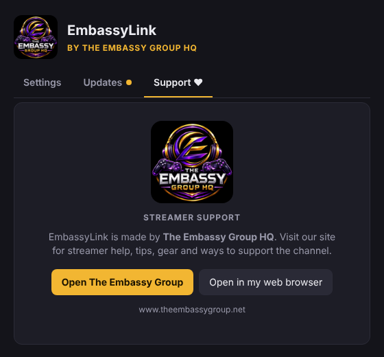

  

<h1 align="center">Welcome to EmbassyLink</h1>

<b>by The Embassy Group HQ</b>

<i>Every stream chat. One screen.</i>

  <a href="https://github.com/ADDPOC/multichat-releases/releases/latest"><b>⬇ Download the latest version for Windows</b></a>
  &nbsp;·&nbsp;
  <a href="https://www.theembassygroup.net"><b>Visit The Embassy Group HQ</b></a>

---

## Welcome, streamer

Thanks for trying **EmbassyLink**. It brings your **Twitch, YouTube, TikTok, Kick and Facebook Live** chats together in one see-through chat box. You can drag it anywhere on your screen, resize it, and float it over your game, so you never miss a message from any platform while you're live.

**What you get**

- 💬 **One chat box for every platform**, with each message tagged by where it came from (TW, YT, TT, KK, FB)
- 🪟 **See-through, movable and resizable**, and it stays on top of your game
- 🔒 **Click-through lock**: lock the box and your clicks go straight to the game underneath
- 🎥 **OBS / Streamlabs ready**: put the same combined chat on your stream as a browser source
- 🎁 **Super Chats and TikTok gifts** are highlighted so you can thank supporters
- 🔄 **Automatic updates**: new fixes download by themselves

---

## Install in 3 steps

1. **Download.** Go to the **[latest release](https://github.com/ADDPOC/multichat-releases/releases/latest)** and, under **Assets**, click **`EmbassyLink-Setup-….exe`**.
2. **Run the installer.** Open the downloaded file. If Windows shows **"Windows protected your PC"**, click **More info → Run anyway**. This appears because the app is new and not yet digitally signed.
3. **Done.** EmbassyLink installs by itself, adds a **desktop icon** and a **Start menu** entry, and opens.

> Requires Windows 10 or 11 (64-bit). No other software needed.

---

## Set up your channels (about 2 minutes)

The **Settings** window opens the first time you run EmbassyLink. Switch on each platform you stream to and type your channel name:

| Platform | What to type | Login needed? |
|---|---|---|
| **Twitch** | Your channel name (the part after `twitch.tv/`) | No |
| **YouTube** | Your **@handle** (for example `@YourChannel`) | No |
| **TikTok** | Your username, without the @ | No |
| **Kick** | Your channel name (the part after `kick.com/`) | No |
| **Facebook** | Page ID and Page access token (advanced, optional) | Yes |

Click **Send test messages** to see how the chat box looks. YouTube and TikTok connect automatically within about a minute of going live.

**Handy shortcuts (they work from any app):**

| Keys | What it does |
|---|---|
| `Ctrl` + `Shift` + `L` | Lock / unlock click-through |
| `Ctrl` + `Shift` + `H` | Hide / show the chat box |
| `Ctrl` + `Shift` + `M` | Open Settings |

**Put it on stream:** in OBS, add a **Browser** source with the URL `http://localhost:3939/` (about 400 × 600).

---

## Join The Embassy Group HQ

EmbassyLink is made by **The Embassy Group HQ**, a gaming community for streamers. Join us anytime for **added gamer support**, streaming tips and help getting set up, and to connect with other creators.

### 👉 [www.theembassygroup.net](https://www.theembassygroup.net)

**You can reach us from inside EmbassyLink too:**

- Click the **♥ heart** button on the chat box's top bar (hover over the box to see it), **or**
- Open **Settings** and go to the **Support ♥** tab.

On the Support tab, **Open The Embassy Group** opens our website in its own EmbassyLink window, and **Open in my web browser** opens it in Chrome, Edge or your usual browser.

  

---

## Updates

EmbassyLink checks for updates whenever it opens and every few hours. When an update is ready, a gold **⬆** appears on the chat box. Click it, or go to **Settings → Updates → Restart and update**. Your settings are always kept.

## Need help?

- Each platform in **Settings** shows a status line (**Connected**, **Waiting** or **Problem**) explaining what's going on.
- **Waiting: not live yet** is normal. It connects shortly after you go live.
- Still stuck? Reach out through **[The Embassy Group HQ](https://www.theembassygroup.net)**. A screenshot of your Settings window helps us help you fast.

---

© The Embassy Group HQ · Advanced Dispatch Dynamics. EmbassyLink is not affiliated with or endorsed by Twitch, YouTube, TikTok, Kick or Meta.

